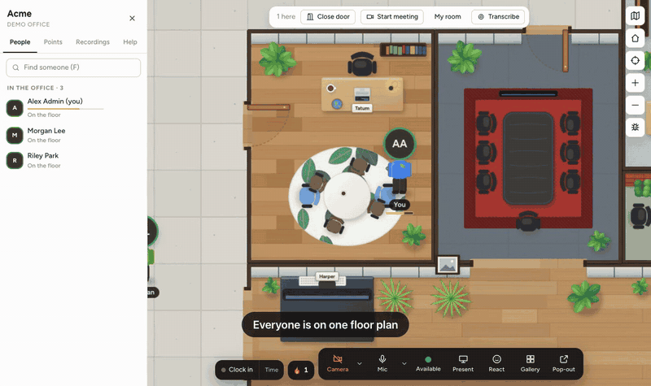

# Proximity Office



A virtual office you host yourself. Everyone is a little figure on a 2D floor plan: walk up to someone and you hear them, walk away and you don't. Close a door to meet privately, knock to get in, invite a guest into one room. It also has room transcription with AI notes, time tracking, and an AI floor designer.

It runs on your own Railway account, so you pay for hosting instead of buying a seat for each person.

- **Proximity audio and video**: voices fade with distance on the open floor. Inside a room, everyone hears everyone, and a closed door is soundproof.
- **Rooms, doors, desks**: knock to enter, a desk for each person, status (Available / Focusing / Away), a minimap, Find, emoji reactions, screen share, a pop-out window.
- **Guests**: an expiring or permanent link that keeps a guest in one room.
- **Transcribe this room**: each teammate's browser records only their own mic, a Whisper service you host turns it into text, and Claude writes notes. The notes go only to the people who were in the room. Guests are never recorded.
- **Time tracking** (`/time`): clock in/out with breaks, weekly timesheets, schedules (overnight shifts too), leave balances and requests, shift swaps, and managers for each team.
- **Office Designer** (admins): describe a change ("add a ping-pong corner to reception") and Claude draws it, or edit by hand. Every change is saved as a version you can undo.
- **Admin**: members and roles, an availability timeline for each person with CSV export, guest links and settings.
- **Fun stuff**: points, streaks, outfits, pets, hidden easter eggs, an optional wall screen (the "jumbotron") for wins, reviews and priorities.

Built with React, Fastify, Socket.IO, Postgres and [LiveKit](https://livekit.io) (open source).

---

## 1. Try it on your computer (10 minutes)

You need **Node 22+** and **LiveKit** (`brew install livekit` on a Mac; see [livekit.io](https://docs.livekit.io/home/self-hosting/local/) for other systems).

```bash
git clone https://github.com/zakkonanz-creator/proximity-office.git
cd proximity-office
npm install
cp env.example .env
```

Edit `.env` so it has just these lines:

```
SESSION_SECRET=paste-the-output-of: openssl rand -hex 32
DEV_LOGIN=1
PUBLIC_BASE_URL=http://localhost:5173
```

Then:

```bash
npm run dev     # starts LiveKit + the API + the web app
```

Open http://localhost:5173 and use the **dev sign-in** on the login page. Open a second browser window (or an incognito one) and sign in as someone else to try walking up and talking. Locally, the database is built in (no Postgres needed); it lives in `.data/`.

## 2. Put it online with Railway

### The quick way: one click

[](https://railway.com/deploy/OfFLtE?referralCode=8-XQWd)

1. **Make a Google sign-in client** (5 minutes):
   - In [Google Cloud Console](https://console.cloud.google.com/apis/credentials), create an **OAuth client ID** (Web application) that asks only for `openid`, `email` and `profile`.
   - Make it **External** if people sign in from more than one Google Workspace.
2. **Click the button.** Railway asks for four things: the Google client ID and secret, your company's email domain (`ALLOWED_EMAIL_DOMAINS`), and your own email (`ADMIN_EMAILS`). Everything else (the database, the media server and its keys, the session secret) is set up for you.
3. **When it's deployed,** copy the app's domain from Railway and add `https://YOUR-APP-DOMAIN/auth/google/callback` as a redirect URI on the Google client.
4. **Open the domain and sign in.** You're the admin.

Transcription isn't in the one-click setup. Add it afterwards (see "Optional: transcription" below).

### The manual way

You'll make one Railway project with four pieces: **Postgres**, **app**, **livekit** and, optionally, **transcriber**.

1. **Install the Railway CLI** and sign in: `npm i -g @railway/cli && railway login`.
2. **Create a project** at [railway.com](https://railway.com) and name it `proximity-office`. Add a **Postgres** database to it.
3. **Media server (livekit)**
   - Add an empty service named `livekit`.
   - In its Settings → Networking, add a **public domain** (port 7880) and a **TCP proxy** (port 7881). Railway has no UDP, so audio and video travel over TCP through this proxy.
   - Set the variables `PORT=7880`, `LIVEKIT_API_KEY` and `LIVEKIT_API_SECRET` (any two random strings, e.g. `openssl rand -hex 24`).
   - Deploy: `./deploy.sh livekit`. Opening its domain should show `OK`.
4. **Google sign-in**
   - In [Google Cloud Console](https://console.cloud.google.com/apis/credentials) create an **OAuth client ID** (Web application) that asks only for `openid`, `email` and `profile`.
   - Make it **External** if people sign in from more than one Google Workspace.
   - Set the redirect URI to `https://YOUR-APP-DOMAIN/auth/google/callback`. You'll get that domain in the next step; you can add it afterwards.
5. **The app**
   - Add an empty service named `app` and give it a public domain.
   - Set the variables from the **Required** section of [`env.example`](env.example): `PUBLIC_BASE_URL`, `SESSION_SECRET`, `DATABASE_URL=${{Postgres.DATABASE_URL}}`, the Google client ID and secret, `ALLOWED_EMAIL_DOMAINS`, `ADMIN_EMAILS`, and `LIVEKIT_URL` (`wss://` + the livekit domain) with the same `LIVEKIT_API_KEY` and `LIVEKIT_API_SECRET`.
   - Deploy: `./deploy.sh`.
6. Open your app's domain and sign in. The emails in `ADMIN_EMAILS` become admins.

**Optional: transcription.**
- Add a service named `transcriber`.
- Set `TRANSCRIBER_KEY` (any random 32+ characters) on it, then run `./deploy.sh transcriber`.
- On the app, set `TRANSCRIBER_URL`, the same `TRANSCRIBER_KEY`, and `ANTHROPIC_API_KEY` (used for the notes).
- Turning on **App Sleeping** for the transcriber keeps it cheap.
- [`transcriber/README.md`](transcriber/README.md) explains how to pick the Whisper model.

**Optional integrations.** Each one stays off until you set its variables in `env.example`:
- **Slack**: photos, a "Message on Slack" button and DMs. Create the app from `deploy/slack-app-manifest.json`.
- **Google Calendar/Meet/Drive** and **Fathom**: record meetings.
- **The wall screen**: Slack wins, new clients, Google reviews, Notion priorities. Steps below.
- **GoHighLevel Meeting Rooms**: each person pastes their own room link.

**Optional: the wall screen.** Put a "jumbotron" on a wall with the Designer, then turn on the feeds you want. Each one stays empty until it's set up.
1. **Wins**: invite your Slack app to a channel and set `WINS_CHANNEL` (default `wins`). Points given with "post it" show up here too.
2. **New clients and onboarding**: make a Slack channel where you post one message per new client: the client's name on the first line, then their email and the product on the next lines. React 👀 when someone picks it up and ✅ when onboarding is done. Invite your Slack app to that channel, then set `JUMBOTRON_SLACK_TOKEN` (its bot token, with `channels:history`) and `JUMBOTRON_SLACK_CHANNEL` (the channel id).
3. **Quarterly priorities**: share a Notion database with an integration and set `NOTION_TOKEN` and `NOTION_ROCKS_DATA_SOURCE`. Rows need a title and a Status; a Quarter property ("Q1 2027") limits it to this quarter.
4. **Google reviews**: set `GOOGLE_PLACES_API_KEY` and `GOOGLE_PLACE_ID` (your Google Business listing).
5. **Values and key dates**: admins type them in on the screen itself. To keep them in a file instead, set `JUMBOTRON_PUSH_KEY` and push from a script:
   ```bash
   curl -X POST https://YOUR-APP-DOMAIN/api/jumbotron/static \
     -H "x-api-key: $JUMBOTRON_PUSH_KEY" -H "content-type: application/json" \
     -d '{"values":[{"name":"Own it","line":"Say what you will do, then do it."}],"dates":[{"date":"2027-01-15","label":"Kickoff"}]}'
   ```

**Bug and idea reports.** The bug button in the office saves reports for admins (Admin → Reports). To send them somewhere else, set `FEEDBACK_AGENT_KEY` (32+ characters) and have your own bot read `GET /api/agent/feedback` with `Authorization: Bearer <key>`.

## 3. Make it yours

- **Company name**: the app says "Acme" as a placeholder. Find and replace it: `grep -rl Acme web shared server | xargs sed -i '' 's/Acme/Your Company/g'` (on Linux, drop the `''`).
- **Logo**: replace `web/public/logo.svg` (sign-in screen and the logo wall in the office) and `web/public/favicon.svg`.
- **The floor**: `floor/demo-office.json` is a 19-room office with ~440 pieces of furniture. Desks with an `owner` seat that person automatically when they first sign in (the match is by Google display name). Change it by hand, or sign in as an admin and use **Design** in the side panel. Changes made there are saved in the database and win over the file.
- **Easter eggs, outfits, pets, emotes**: `shared/eggs.ts`, `shared/outfits.ts`, `shared/pets.ts`, `shared/emotes.ts`.

## How it works

```
browser ──https──▶ app (Fastify + Socket.IO + Postgres)      who's where, doors, status, analytics, admin
   │
   └──wss/ICE-TCP──▶ livekit (LiveKit OSS on Railway)        audio, video, screen share
```

- **One LiveKit room per floor, and nobody auto-subscribes.** Four times a second, each browser works out who it can hear (`shared/floor.ts → volumeBetween`) and subscribes to exactly those people at that volume. People across the floor cost nothing.
- **Cameras reach fewer people than voices, which keeps hosting cheap.** Video is most of the bandwidth, so cameras are only streamed within a desk or two, or to everyone in an office or meeting room (`media.ts → seesVideo`). Your camera also pauses when you go Away/Focusing or leave the tab in the background (`camPause.ts`).
- **The speaker enforces privacy.** Your browser only *grants* subscriptions to people who can hear you, so a tampered client can't listen through a closed door. The end-to-end tests check this.
- **The server owns doors and room membership.** It refuses moves through a closed door, and keeps guests in their room.
- **Railway has no UDP**, so media runs over TCP through a Railway TCP proxy (`deploy/livekit/entrypoint.sh`). This is choppier than UDP on bad networks. To fix that, run `deploy/livekit` on any VPS with UDP (~$8–15/mo) and change `LIVEKIT_URL`. Nothing else changes.
- **Reconnects resume.** A network blip within 90 seconds doesn't send you back to your desk.

## Tests

The end-to-end tests sign in as made-up people, so start the dev server with these two lines in `.env` as well:

```
ADMIN_EMAILS=admin@example.com
ALLOWED_EMAIL_DOMAINS=example.com,example.org
```

```bash
npm run typecheck
npm test         # unit tests: floor rules, Designer edits, time tracking, points, transcripts…
npm run e2e      # with `npm run dev` running: real browsers, fake cameras, real LiveKit
npm run shots    # screenshots of every screen: desktop, phone, dark mode
```

The demo at the top is made by `scripts/demo-video.ts` then `scripts/demo-gif.sh`.

## Backups

On Railway, turn on **volume backups** for Postgres (Postgres → Backups). Optionally, the app also writes a nightly export of every table to a Google Drive folder (`DRIVE_BACKUP_FOLDER_ID`, then Admin → Settings → Link Drive). Restore it with `scripts/restore-backup.ts`.

## Left out on purpose

Chat (most teams already have Slack or Teams), desktop/mobile apps (the web app works on phones), password sign-in (Google only).

## License

MIT. See [LICENSE](LICENSE).
